# Smart Site（SS）— 工业组态与数据可视化平台

Smart Site 是一套面向工业场景的**组态编辑器 + 数据中台 + 后端服务**一体化平台，支持拖拽式监控画面编辑、设备数据采集（Modbus / OPC UA / MQTT / S7）、数据标签与模板、报警引擎、脚本引擎与多语言国际化。

> 开发协作与编码规范详见仓库内的 [`AGENTS.md`](./AGENTS.md)（面向 AI 编码助手与开发者的导航索引）。

---

## 在线体验（演示站点）

不想本地部署，可直接访问已上线运行的演示环境，快速体验平台全部能力：

- **访问地址**：<https://smartsite.top/>
- **测试账号**：用户名 `test` ／ 密码 `test`
- 登录后即可使用组态编辑器（拖拽式画面编辑、图元绑定、数据联动）与数据中台（设备管理、数据标签、报警、报表）等功能。

> 演示站点为公开共享实例，仅用于功能体验，请勿写入重要业务数据。
>
> 所有组态页面均为演示用途，不涉及相关工艺及真实数据，页面中的工艺与数据均为模拟产生，仅用于展示组态功能。

---

## 界面预览

以下为系统运行界面截图（图片位于仓库 `docs/screenshots/` 目录，对应线上演示站点 <https://smartsite.top/> 的实际界面，在 Gitee 上可直接查看）：

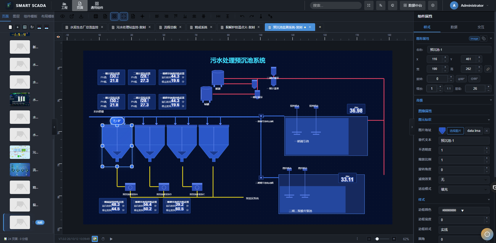

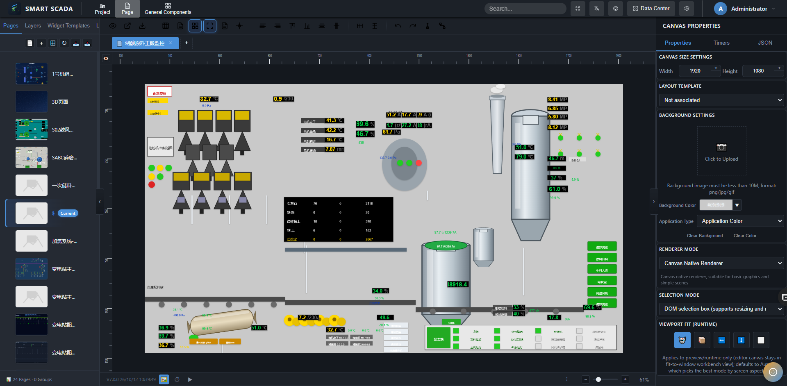


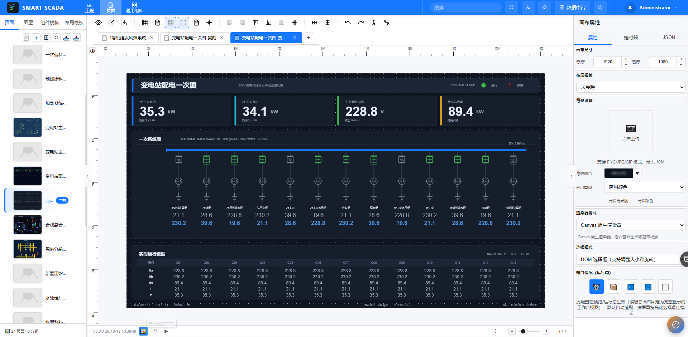

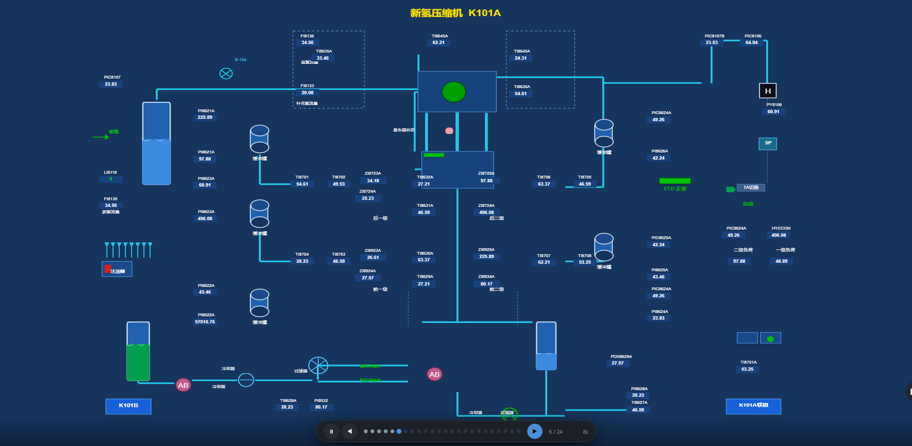
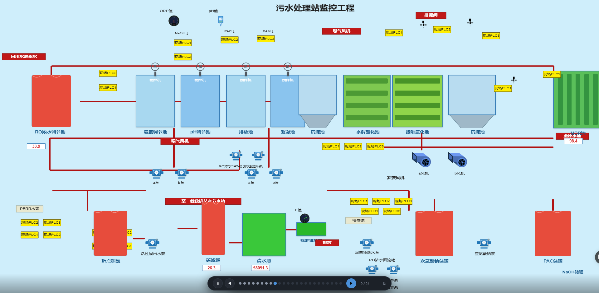


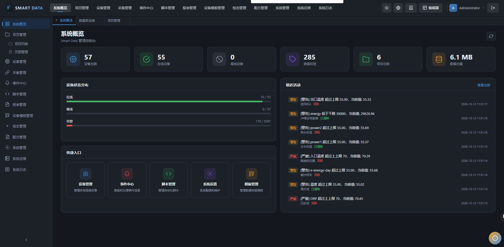
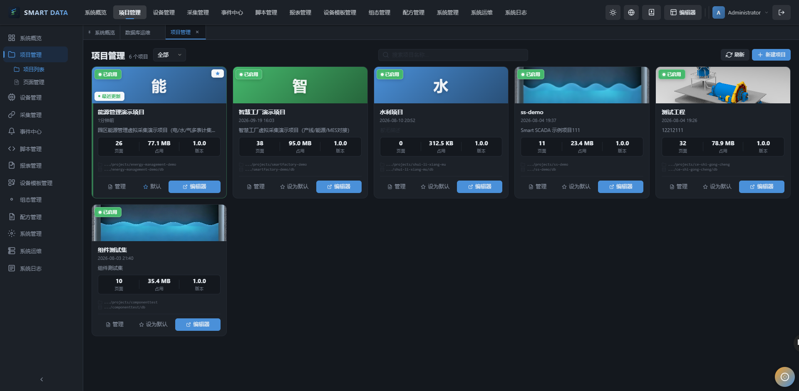

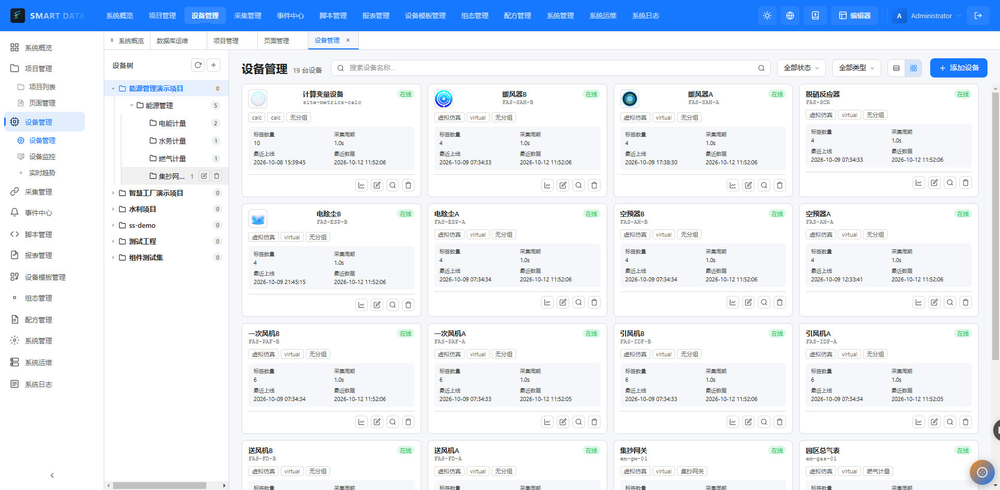


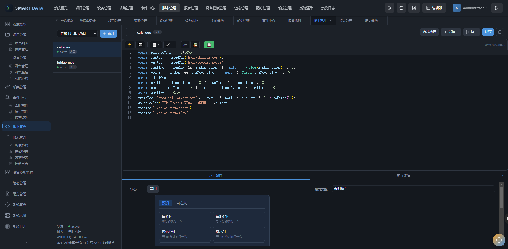

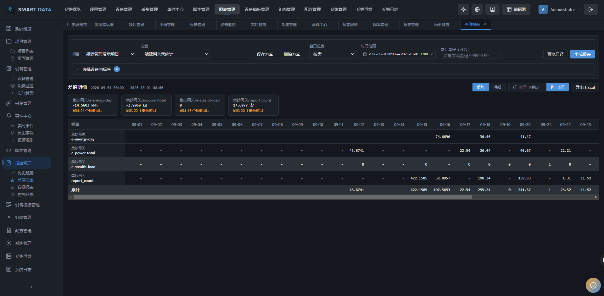
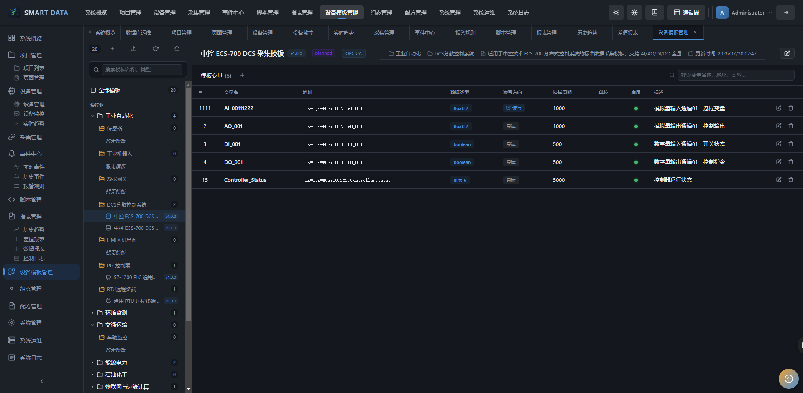
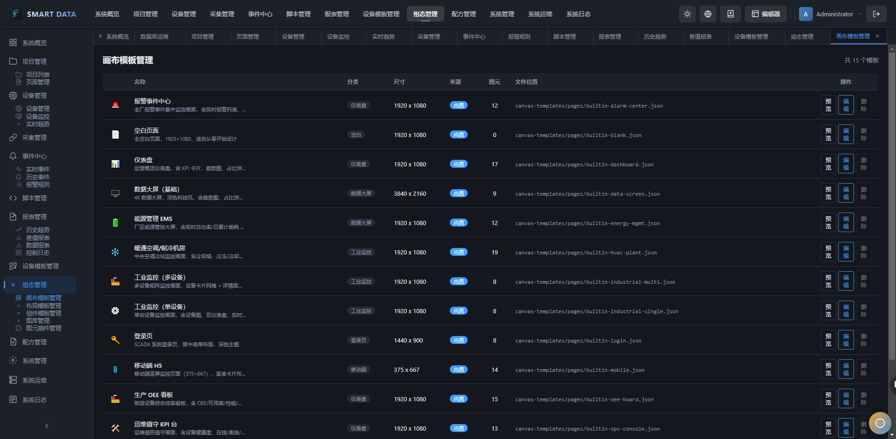

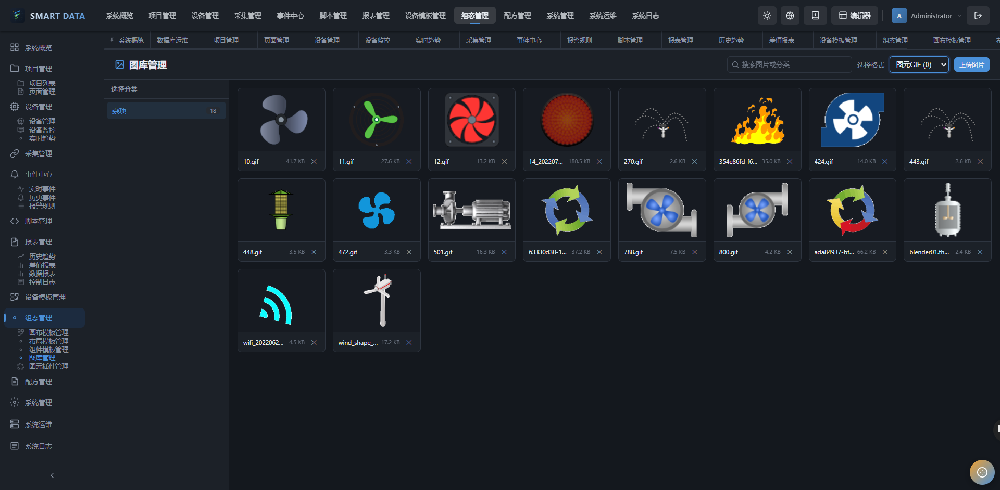


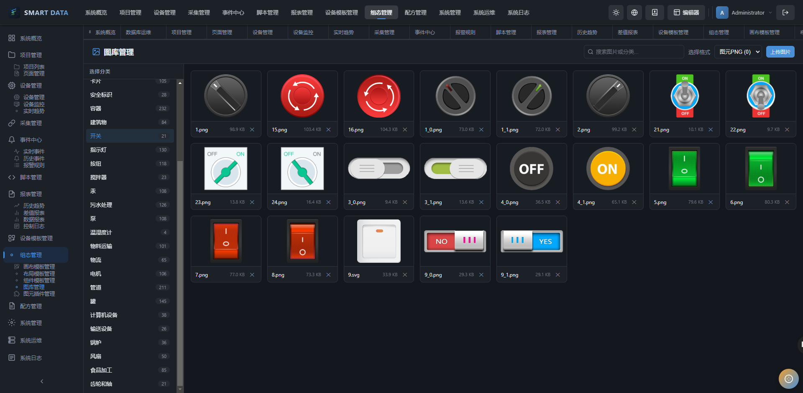


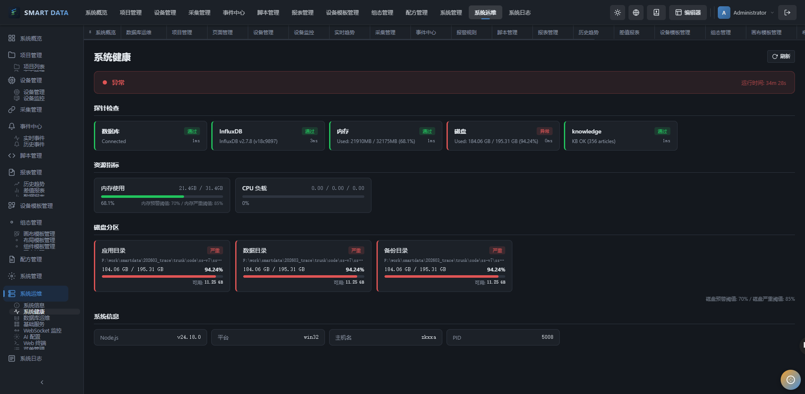


---

## 技术栈

### 前端（`ss-editor`）

| 技术 | 版本 | 用途 |
| --- | --- | --- |
| Vue 3 | 3.x | Composition API + `<script setup>` |
| TypeScript | 5.2 | 严格模式 |
| Vite | 5.x | 构建 / 开发服务器 |
| Pinia | — | 状态管理 |
| Konva（vue-konva） | — | 画布渲染 |
| Naive UI | — | UI 组件库 |
| vue-i18n | — | 国际化 |
| Vue Router | 4.x | 路由 |
| Vitest | 1.6 | 单元测试 |
| Playwright | 1.60 | E2E 测试 |

### 后端（`ss-services/ss-node`）

| 技术 | 版本 | 用途 |
| --- | --- | --- |
| NestJS | 10.4 | 应用框架 |
| TypeScript | 5.2 | 严格模式 |
| TypeORM | 0.3 | ORM |
| SQLite（better-sqlite3） | — | 元数据存储（按项目独立 DB） |
| InfluxDB | 2.7+ | 时序数据存储（可选） |
| Socket.IO | 4.x | WebSocket 实时通信 |
| @nestjs/jwt + passport | — | JWT 认证 + RBAC |
| Jest / ts-jest | 29.7 | 单元测试 |
| Supertest | 7.2 | HTTP 集成测试 |
| node-opcua / modbus-serial / mqtt | — | 工业协议采集 |

---

## 仓库结构

本仓库是一个 **pnpm 多包（monorepo）**，由三大部分组成：

```
ss-o/
├── ss-editor/                  # 前端 monorepo（独立的 pnpm workspace）
│   ├── apps/
│   │   ├── web/                # Web 应用入口（Vite dev server）
│   │   ├── desktop/            # Electron 桌面应用
│   │   └── desktop-tauri/      # Tauri 桌面应用
│   └── packages/
│       ├── core/               # 核心库：图元模型、存储、服务、i18n
│       ├── editor/             # 编辑器 UI：布局、菜单、工具栏
│       ├── system/             # 数据中台：视图、路由、API、stores
│       ├── shared/             # 共享 Vue 组件
│       ├── plugins/            # 图元插件包（basic / chart / industrial / electric …）
│       ├── plugin-sdk/         # 插件开发 SDK
│       ├── create-plugin/      # 插件脚手架
│       └── tools/              # 构建工具
│
├── ss-services/ss-node/        # 后端 monorepo（NestJS + pnpm workspace）
│   ├── apps/ss-node-server/    # 主应用入口
│   └── packages/
│       ├── ss-core/            # 基础设施：Auth、EventBus、Pipeline、WebSocket
│       ├── ss-device/          # 设备管理
│       ├── ss-project/         # 项目管理
│       ├── ss-datatag/         # 数据标签
│       ├── ss-alarm/           # 报警管理
│       ├── ss-system/          # 系统管理（配置、菜单、终端）
│       ├── ss-report/          # 报表
│       ├── ss-script/          # 脚本引擎
│       ├── ss-datasource/      # 外部数据源
│       ├── ss-storage/         # 存储引擎（InfluxDB 等）
│       ├── ss-collector/       # 工业协议采集器（modbus/mqtt/opcua/s7/virtual）
│       ├── ss-i18n/            # 后端国际化
│       └── ss-cli/             # CLI 工具
│
├── ss-run/ss/data/             # 运行时数据目录（默认整体 gitignore）
│   └── ……                      # 已纳入版本控制的配置/静态数据：
│                                 #   canvas-templates / templates / init /
│                                 #   dicts / plugin-configs / graphic-plugins /
│                                 #   menu / rtdb / realtime / exports / logs-data / images
│
├── bin/                        # 启动 / 调试脚本（见下方"快速开始"）
├── types/                      # 全局共享类型
├── AGENTS.md                   # 开发协作与编码规范导航
├── pnpm-workspace.yaml         # pnpm 工作区配置（后端）
├── package.json                # 根聚合脚本
└── LICENSE                     # Apache-2.0
```

> **运行时数据目录 `ss-run/`**：默认整体被 `.gitignore` 忽略，仅其中的配置/静态数据子目录纳入版本控制；运行时产生的大文件（数据库 `*.db`、日志 `logs/`、AI 索引 `faq/`、模型 `models/`、采集报告 `ai-workspace/` 等）不入库，避免仓库体积膨胀。

---

## 环境要求

- **Node.js** ≥ 18（建议 20 LTS）
- **pnpm** ≥ 8（根 `package.json` 已锁定 `pnpm@11`）
- （可选）**InfluxDB 2.7+**：用于时序数据存储
- （可选）**Redis**：用于实时数据缓存

---

## 快速开始

### 1. 安装依赖

前端与后端是两个独立的 pnpm 工作区，需分别安装：

```bash
# 后端（仓库根目录）
pnpm install

# 前端
cd ss-editor
pnpm install
cd ..
```

### 2. 启动（推荐使用 `bin/` 脚本）

项目提供三种产品模式的启动脚本，封装了依赖安装、workspace 编译、环境变量与缓存清理，**日常启动/重启/切换模式请优先使用这些脚本，而不是直接 `pnpm dev`**。

| 模式 | 脚本 | 前端端口 | 后端端口 | 适用场景 |
| --- | --- | --- | --- | --- |
| 全栈（默认） | `.\bin\start.bat` | 5173 | 3000 | 同时开发编辑器 + 数据中台 |
| data 模式 | `.\bin\start-data.bat` | 5175 | 4000 | 仅数据中台（禁用 `/editor`、`/preview`） |
| scada 模式 | `.\bin\start-scada.bat` | 5174 | 4100 | 仅组态编辑器（禁用 `/system/*`） |

调试单个端 / 重试：

```powershell
.\bin\start-backend.bat     # 仅启动后端
.\bin\start-frontend.bat    # 仅启动前端（Vite dev）
.\bin\run-desktop.bat       # 启动 Electron 桌面应用
.\bin\kill-node.bat         # 杀掉残留 Node 进程
.\bin\clear-vite-cache.bat  # 清理前端缓存 + 重新编译 workspace 包
```

启动后访问：

- 组态编辑器：`http://localhost:5173/editor`
- 数据中台：`http://localhost:5173/system`
- 后端 API（Swagger）：`http://localhost:<后端端口>/api-docs`

---

## 开发与构建命令

### 前端（`ss-editor`）

```bash
cd ss-editor

pnpm dev:web:full     # 全栈模式开发（编辑器 + 数据中台）
pnpm dev:web:scada    # 仅组态编辑器
pnpm dev:web:data     # 仅数据中台

pnpm build:web:full   # 全量构建（core → editor → system → web）
pnpm build:web:scada
pnpm build:web:data
pnpm build:desktop    # 构建 Electron 桌面应用
pnpm build:tauri      # 构建 Tauri 桌面应用

pnpm test:core        # core 包单测
pnpm test:ui          # editor 包单测
pnpm test:all         # 全部单测
pnpm test:e2e         # Playwright E2E
pnpm typecheck        # 类型检查
pnpm lint             # 代码风格
```

### 后端（`ss-services/ss-node`）

```bash
cd ss-services/ss-node

pnpm dev              # 开发模式（自动编译 workspace 包 + 热重载）
pnpm build            # 构建全部包
pnpm start:prod       # 生产模式

pnpm --filter ss-node-server dev        # 仅启动主应用
pnpm --filter @ss-node/ss-device build  # 构建单个包（workspace 包改后需重编）

pnpm test             # 全部测试
pnpm typecheck        # 类型检查
pnpm lint             # 代码风格
```

### 根目录聚合脚本

```bash
pnpm build:server        # 构建后端主应用
pnpm build:web:full      # 全量构建前端
pnpm build:all           # 后端 + 前端全量构建
```

---

## 配置

### 后端环境变量

后端配置位于 `ss-services/ss-node`（参考 `.env.example` 复制为 `.env`）：

```env
NODE_ENV=development
PORT=4000                 # 后端端口（各启动模式由 bin 脚本预检/覆盖）
JWT_SECRET=change-me      # 生产环境务必修改
INFLUXDB_URL=http://localhost:8086   # 时序数据（可选）
INFLUXDB_TOKEN=...
INFLUXDB_ORG=ss-org
INFLUXDB_BUCKET=ss_node_data
LOG_LEVEL=debug
```

数据库：全局元数据存于 `ss-node.db`，各项目数据按项目隔离存于 `{项目目录}/db/system.db`，首次启动自动建库。

### 前端环境变量

前端由 Vite 注入（参考 `ss-editor/apps/web` 下的 `.env*`）：

```env
VITE_API_BASE_URL=http://localhost:4000   # 后端 API 地址
VITE_WS_URL=ws://localhost:4000           # WebSocket 地址
VITE_DEBUG_SKIP_AUTH=true                 # 仅开发：跳过登录鉴权
```

---

## 测试

```bash
# 前端
cd ss-editor && pnpm test:all && pnpm test:e2e

# 后端
cd ss-services/ss-node && pnpm test
```

门禁流程：**编写代码 → typecheck → lint → test → Code Review → 提交**。

---

## 编码规范（摘要）

详细规范见 [`AGENTS.md`](./AGENTS.md)，要点：

- **主题样式**：所有颜色必须用 CSS 变量（`--primary`、`--surface`、`--text`、`--border` 等），禁止硬编码颜色。
- **国际化**：新增 UI 文本必须使用 `$t('...')` 并同步 `zh-CN.json` / `en-US.json`。
- **TypeScript 严格模式**：禁止 `any`，优先具体类型或泛型。
- **命名**：禁止缩写，领域标识符使用全称（`projectId` / `deviceId` / `tagId` / `userId` 等，禁用 `pid`/`did`/`tid`/`uid`）。
- **提交信息**：简易中文 + 模块前缀，例如 `feat: 设备管理-分组支持拖拽排序`、`fix: 系统-菜单配置缺失`。
- **启动脚本**：启动/重启/切换模式/重试必须使用 `bin/` 脚本。

---

## 联系与关注

<table>
  <tr>
    <td align="center"><br/><strong>微信公众号</strong><br/>扫码关注，获取产品动态与更新通知</td>
    <td align="center"><br/><strong>视频号</strong><br/>扫码关注，观看产品演示与使用教程</td>
    <td align="center"><br/><strong>开发者微信</strong><br/>扫码添加，进行技术交流与问题咨询</td>
  </tr>
</table>

> 如果本项目对您有帮助，欢迎 **关注公众号与视频号**，并帮忙 **点赞、转发** 给更多有需要的朋友；您的关注与支持是我们持续更新与完善的动力。也欢迎添加开发者微信交流反馈问题或建议。

## 许可证

[Apache-2.0](./LICENSE)
