#  Smart SCADA Services - Node.j

基于 NestJS 的工业 SCADA 后端服务（Monorepo 架构），提供完整的组态管理、设备通信、数据采集和报警处理功能

##  📦 Monorepo 结

```
ss-data/                          ← 根目录（Monorepo 管理）
├── apps/
│   └── ss-data-server/           ← 主应用（NestJS 启动入口）
├── packages/                      ← 核心包（可复用模块）
│   ├── ss-core/                  ← @ss-node/ss-core（认证、用户、WebSocket、报警、Pipeline）
│   ├── ss-device/               ← @ss-node/ss-device（设备管理）
│   ├── ss-project/              ← @ss-node/ss-project（项目管理）
│   ├── ss-sdk/                  ← @ss-node/ss-sdk（公共类型定义）
│   ├── ss-storage/              ← @ss-node/ss-storage（数据存储抽象）
│   └── ss-collector/           ← @ss-node/ss-collector（数据采集框架）
├── data/                         ← 数据目录（SQLite、配置）
├── docs/                         ← 技术文档
├── package.json                  ← Monorepo 根配置
├── pnpm-workspace.yaml          ← Workspace 配置
└── tsconfig.json                ← TypeScript 根配置
```

##  技术

- **\*框***: NestJS 10.
- **\*语***: TypeScript 5.
- **\*元数据***: SQLite 3.35+（轻量级，零配置
- **\*时序数据***: InfluxDB 2.7+（高效时序存储
- **\*OR***: TypeORM 0.3.
- **\*认***: JWT + Passpor
- **\*实时通***: Socket.IO 4.
- **\*工业协***: Modbus TCP/RTU, OPC UA, MQT
- **\*API文***: Swagger/OpenAP
- **\*日***: Winston 3.
- **\*包管***: pnpm (Monorepo

##  核心模

|  包                  |  职                                                       |  状        |
| -------------------- | --------------------------------------------------------- | ---------- |
| `@ss-node/core`      |  认证(JWT)、用户管理、WebSocket网关、报警引擎、Pipeline框 |  🟢 基础完 |
| `@ss-node/device`    |  设备CRUD、数据标签管理、连接状态                         |  🟡 进行   |
| `@ss-node/project`   |  项目/页面管理、导入导                                    |  🟢 基本完 |
| `@ss-node/sdk`       |  公共类型定义、接口契                                     |  🟢 完     |
| `@ss-node/storage`   |  双存储抽象（SQLite快照 + InfluxDB历史                    |  🟡 进行   |
| `@ss-node/collector` |  数据采集Pipeline、协议适配器框                           |  🔴 待开   |
| `ss-data-server`     |  主应用（Controller、Module组装、Swagger                  |  🟢 基础完 |

##  功能特

- **\*项目管***：创建、编辑、删除、导入导出、多页面管
- **\*设备管***：多种工业设备支持、数据标签管理、连接状态监
- **\*数据采***：Pipeline责任链、Modbus/OPC UA/MQTT协议、背压控
- **\*报警系***：多级报警、规则配置、确认清除、实时推
- **\*数据存***：双写策略（SQLite快照 + InfluxDB时序）、自动降采
- **\*认证权***：JWT认证、角色权限管理（admin/user/viewer
- **\*实时通***：WebSocket推送、房间隔离、心跳检

## 界面预览

以下为系统运行界面截图，图片文件位于仓库 `docs/图片/` 目录：

<details>
<summary>点击展开全部界面截图（共 35 张）</summary>


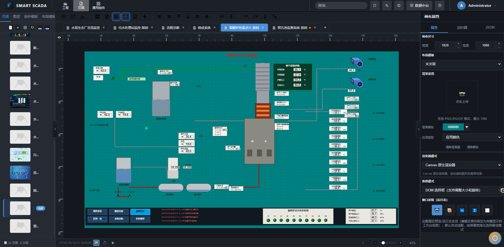

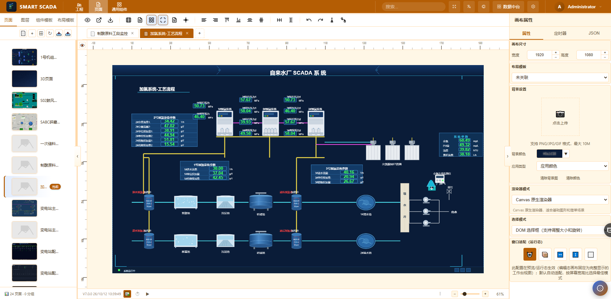
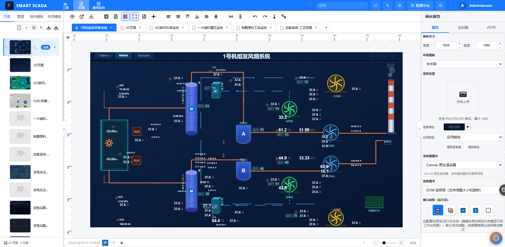

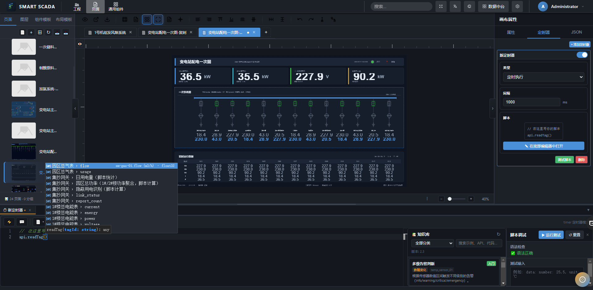


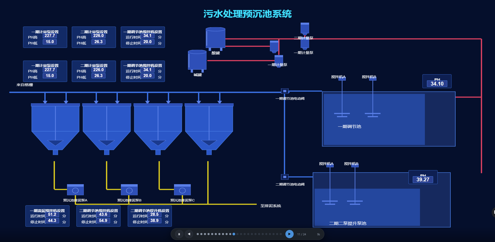
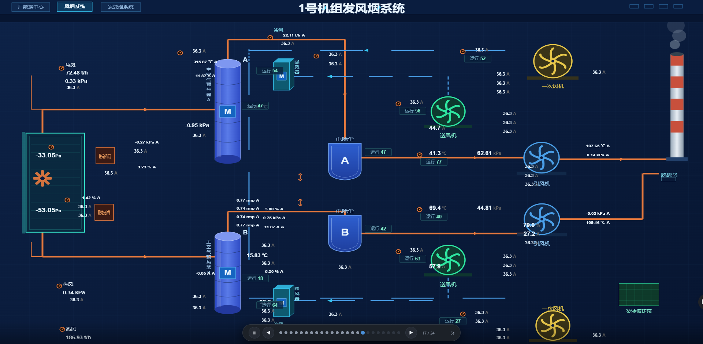


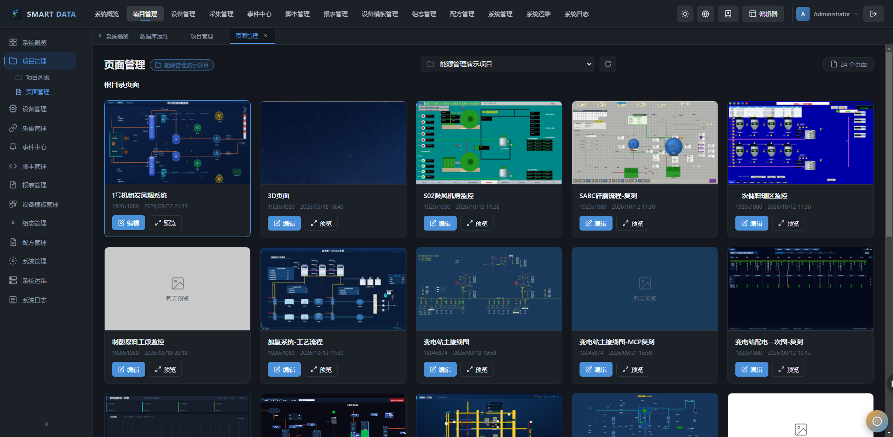

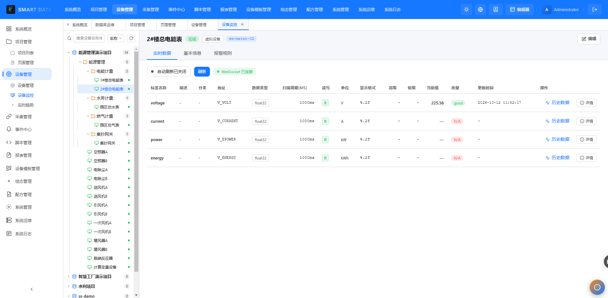
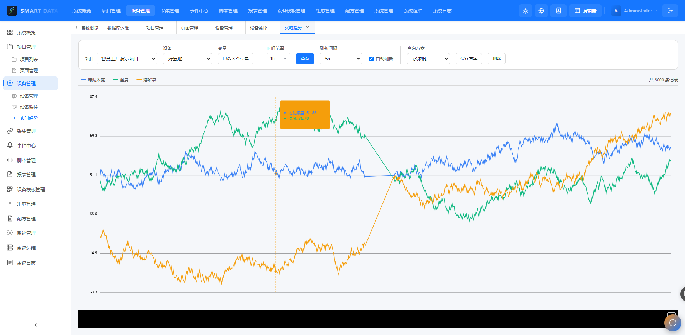
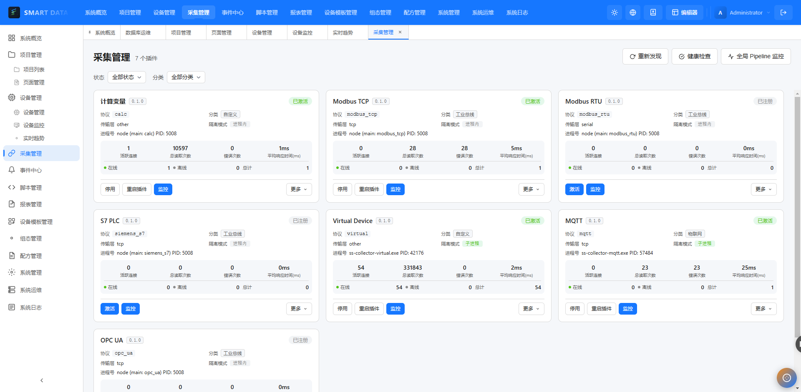
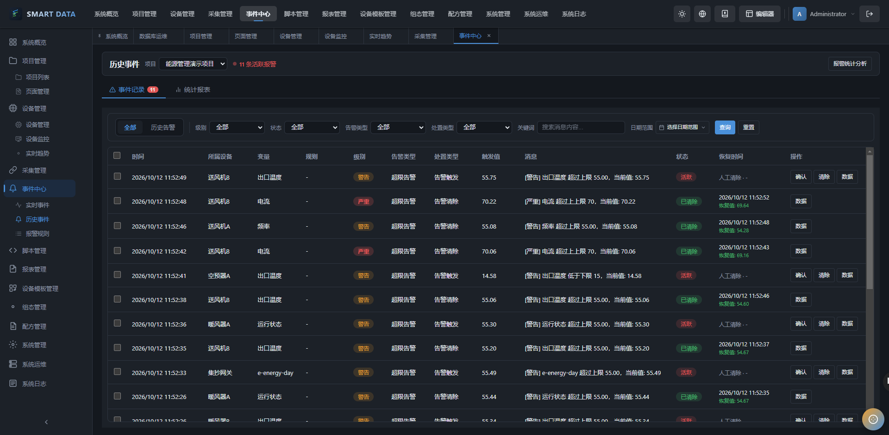
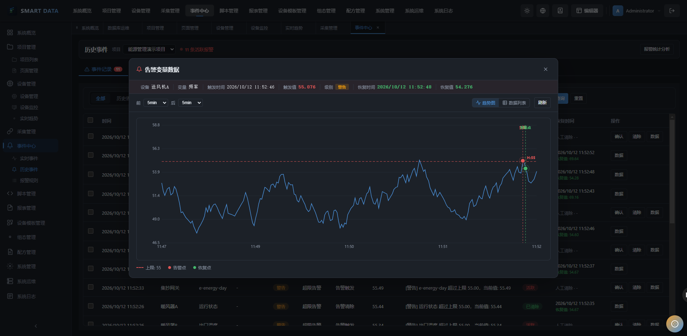

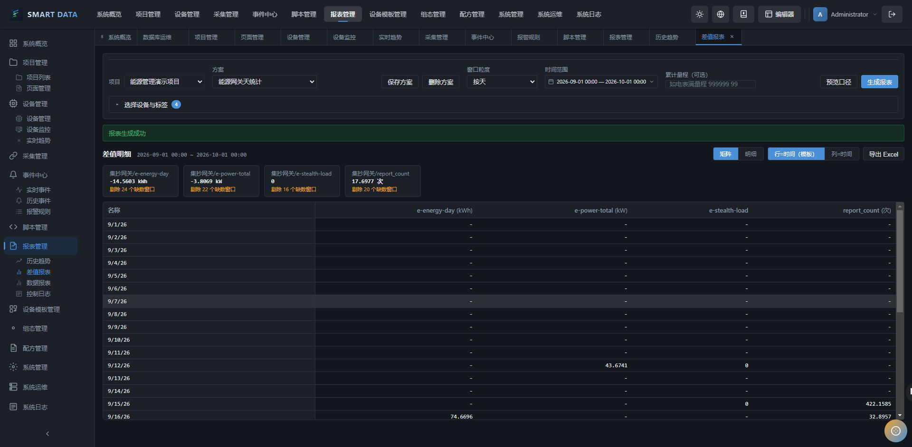


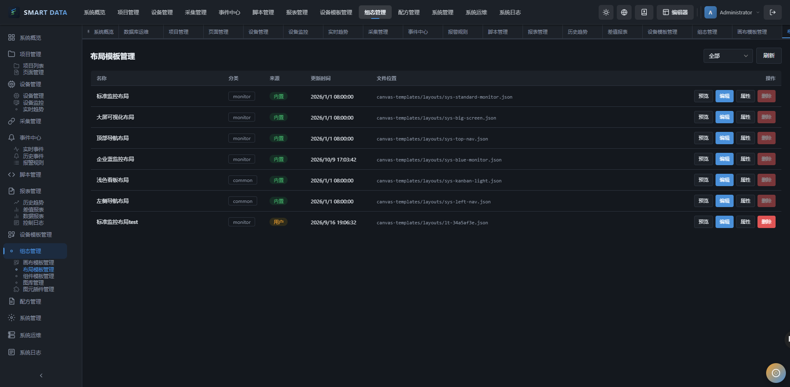

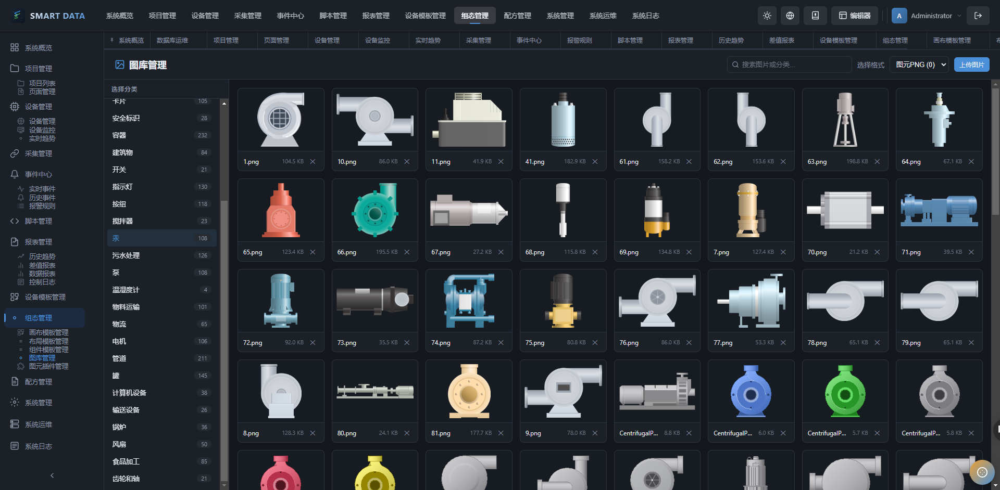
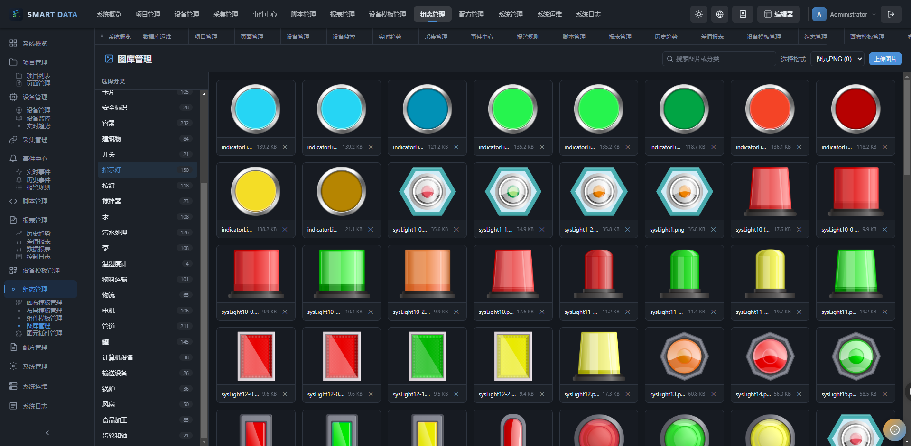

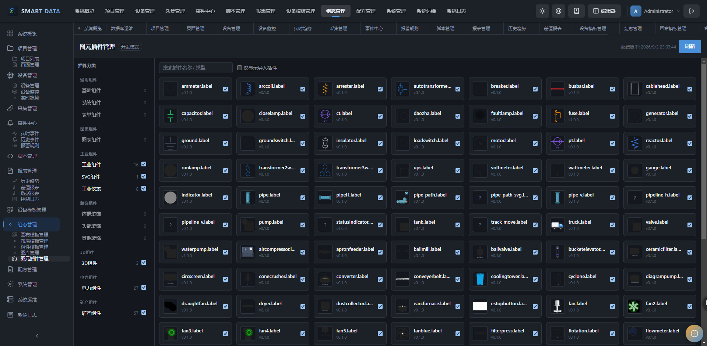
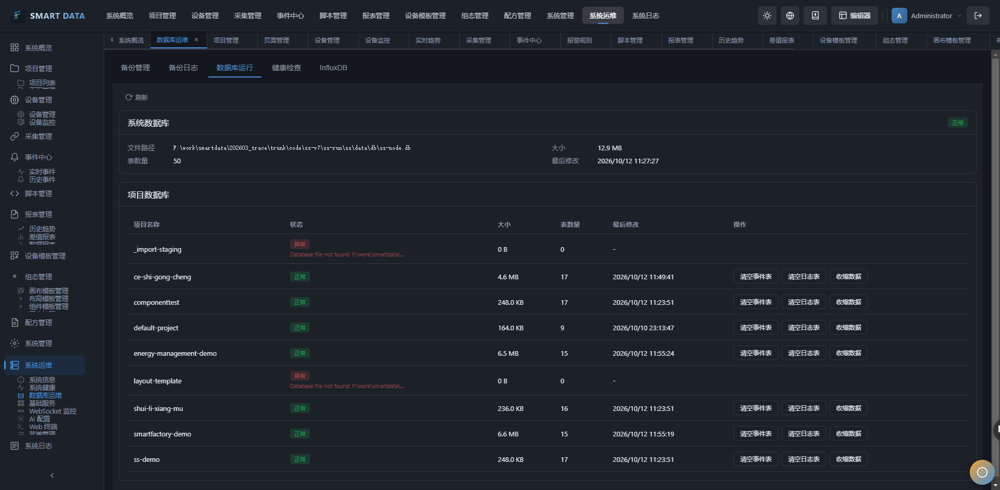
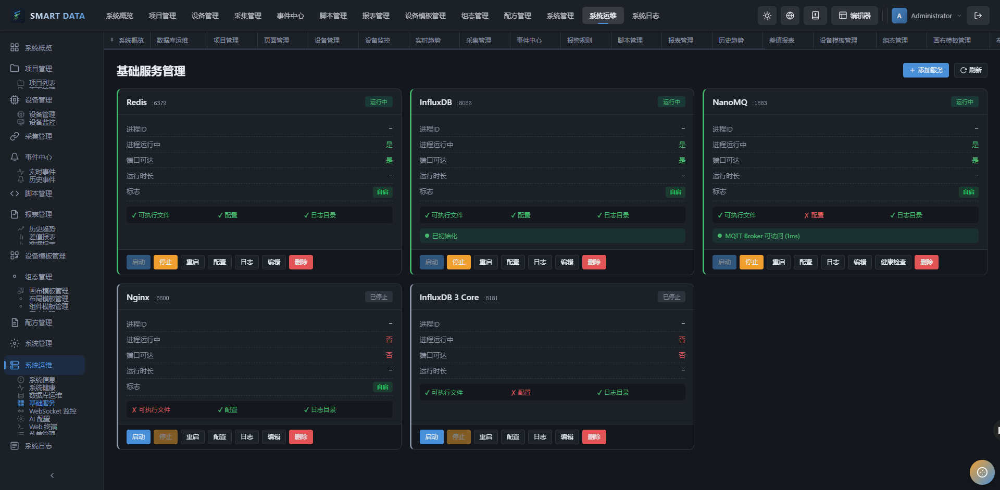

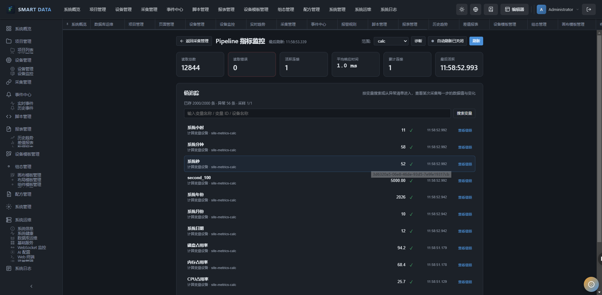

</details>

##  快速开

###  前置要

- Node.js >= 1
- pnpm >=
- SQLite 3.35+（轻量级，零配置
- InfluxDB 2.7+（可选，用于时序数据存储
- Redis（可选，用于缓存

###  安装依

```bash
cd ss-services/ss-data
pnpm install
```

###  环境配

复制环境变量示例文件

```bash
cp .env.example .env
```

编辑`.env`` 文件，配置应用参数

```env
# 应用配置
NODE_ENV=development
PORT=4000

# SQLite 配置（元数据）
DATABASE_PATH=../../ss-run/ss/data/db/ss-data.db

# InfluxDB 配置（时序数据，可选）
INFLUXDB_URL=http://localhost:8086
INFLUXDB_TOKEN=ss-data-deployment-token
INFLUXDB_ORG=ss-org
INFLUXDB_BUCKET=ss_node_data

# JWT配置
JWT_SECRET=your-super-secret-jwt-key-change-this-in-production
JWT_EXPIRES_IN=7d

# 日志级别
LOG_LEVEL=debug
```

###  数据库初始

SQLite 数据库会自动创建（文件不存在时）。InfluxDB 需要手动创建 Bucket

###  启动应

```bash
# 开发模式（支持热重载）
pnpm start:dev

# 生产模式
pnpm build
pnpm start:prod
```

###  访问API文

启动应用后，访问以下地址查看 Swagger 文档

```
http://localhost:4000/api-docs
```

##  API 接口说

所有接口统一前缀`/api/v1`

###  认证接

|  方  |  路                     |  说     |
| ---- | ----------------------- | ------- |
|  POS | `/api/v1/auth/register` |  用户注 |
|  POS | `/api/v1/auth/login`    |  用户登 |

###  项目管理接

|  方    |  路                           |  说         |
| ------ | ----------------------------- | ----------- |
|  GE    | `/api/v1/projects`            |  获取项目列 |
|  POS   | `/api/v1/projects`            |  创建项     |
|  GE    | `/api/v1/projects/:id`        |  获取项目详 |
|  PATC  | `/api/v1/projects/:id`        |  更新项     |
|  DELET | `/api/v1/projects/:id`        |  删除项     |
|  POS   | `/api/v1/projects/:id/export` |  导出项     |
|  POS   | `/api/v1/projects/import`     |  导入项     |

###  设备管理接

|  方    |  路                                       |  说         |
| ------ | ----------------------------------------- | ----------- |
|  GE    | `/api/v1/projects/:projectId/devices`     |  获取设备列 |
|  POS   | `/api/v1/projects/:projectId/devices`     |  创建设     |
|  GE    | `/api/v1/projects/:projectId/devices/:id` |  获取设备详 |
|  PATC  | `/api/v1/projects/:projectId/devices/:id` |  更新设     |
|  DELET | `/api/v1/projects/:projectId/devices/:id` |  删除设     |

###  WebSocket 事

####  客户端发

|  事件              |  说             |
| ------------------ | --------------- |
| `subscribe:data`   |  订阅项目数据更 |
| `unsubscribe:data` |  取消订         |
| `join:project`     |  加入项目房     |
| `leave:project`    |  离开项目房     |

####  服务端推

|  事件                |  说             |
| -------------------- | --------------- |
| `data:update`        |  数据更新事     |
| `alarm:trigger`      |  报警触发事     |
| `alarm:acknowledged` |  报警确认事     |
| `device:status`      |  设备状态变更事 |

##  开发说

###  Monorepo 开发流

```bash
# 安装所有依赖
pnpm install

# 构建所有包（按依赖顺序）
pnpm build

# 启动开发模式（热重载）
pnpm start:dev

# 构建单个包
pnpm --filter @ss-node/core build
```

###  添加新工业协

1. 在`packages/ss-collector/`` 下创建协议适配
2. 实现`IProtocolAdapter`` 接
3. 在`ProtocolFactory`` 中注
4. 更新文

##  测

```bash
# 运行所有测试
pnpm test

# 测试单个包
pnpm --filter @ss-node/core test

# 测试覆盖率
pnpm test:cov
```

##  常见问

###  1. SQLite 数据库锁

- 确保单进程访问，或启用 WAL 模
- 检查是否有其他进程占用`.db`` 文

###  2. InfluxDB 连接失

- 检查`INFLUXDB_URL`` 配
- 确认 Token 权限正

###  3. 设备连接失

- 检查设备网络连
- 确认协议配置参数正
- 查看设备状态机日

##  文

详细文档请参考`docs/`` 目录

-  [概要设计](./docs/01-架构设计/概要设计.md
-  [功能列表](./docs/02-功能说明/功能列表.md
-  [详细设计](./docs/05-详细设计.md
-  [开发规范](./DEVELOPMENT_GUIDELINES.md

##  许可

MIT Licens

##  联系方

如有问题或建议，欢迎提交 Issue 或 Pull Request

---

**\*版***: 2.0.0 (Monorepo 架构\
**\*最后更***: 2026-05-1

## 文档更新记录

| 版本 | 日期 | 更新内容 | 模型 |
| ---- | ---- | -------- | ---- |
| v1.0 | — | 初始版本 | — |
| v1.1 | 2026-08-02 | 补充文档更新记录章节（统一规范化） | GLM-5.2 |
